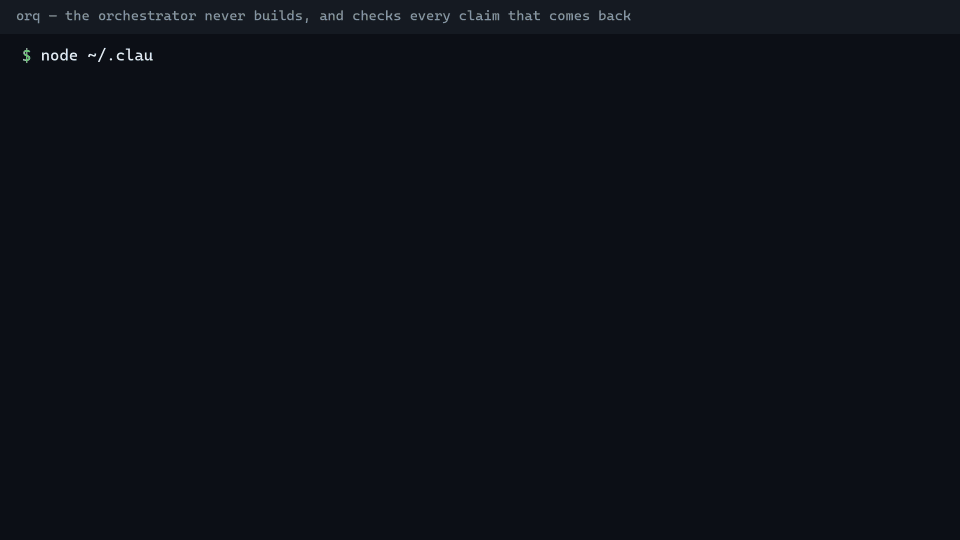

# orq — run several Claude Code terminals in parallel, and trust what they hand back

[](https://github.com/EsmehV99-code/orq/actions/workflows/tests.yml)
[](LICENSE)




A [Claude Code](https://claude.com/claude-code) skill that turns one terminal into an
**orchestrator**: it splits a job into lanes, hands each lane to another terminal or subagent with
a complete brief, and **checks every claim that comes back before letting it in**. The orchestrator
never builds. It works for any task, not just software.

**Why:** with 3+ agents in parallel, the orchestrator is the node with the most inputs and the
least contact with the truth. If it only routes messages, it amplifies every "done" that wasn't.
`orq` makes each lane prove its claims (a receipt with evidence), and a hook watches for the classic
failures: an unverified "0 results", a wait with no deadline, a merge without permission, an
orchestrator that starts editing code itself.



**Quick start — as a plugin** (one line, inside Claude Code; needs `node`):

```
/plugin install orq --marketplace EsmehV99-code/orq
```

Then, in a new terminal inside a git repository, type `/orq`. The plugin brings the 12 hooks, the
commands (`/orq:dashboard`, `/orq:orq-git-permit`…) and the bundled **`/splittasks`** skill in both
variants (`/orq:splittasks-windows`, `/orq:splittasks-macos`: it splits a goal into parallel
terminals and opens them). **Or by hand** (`git clone … ~/.claude/skills/orq` + `install.js`): the
same thing without the `orq:` prefix. One or the other, not both — [Installation](#installation).

- **What it does:** starts on its own when loaded (`/orq`: that is the name of the skill, not a
  shortcut to another one), keeps its state on disk, watches memory and waits, brakes the
  orchestrator if it tries to edit code, and validates briefs and receipts before anyone reads
  their prose.
- **What it does NOT do:** it does not build, it does not integrate, it does not close terminals.

## Start here

| I want to… | Open |
|---|---|
| See the live state | [`docs/DASHBOARD.md`](docs/DASHBOARD.md) |
| See the whole circuit drawn out (parts, a lane's life, the clock) | [`docs/CIRCUIT.md`](docs/CIRCUIT.md) — GitHub renders it on its own |
| The interactive version of the circuit | `docs/circuit.html` (open it in the browser) |
| The clickable map (each piece and its real wiring) | `docs/map.html` (open it in the browser) |
| The laws and the orchestrator's role | [`SKILL.md`](SKILL.md) |
| What each warning detects, and what the owner sees vs. what the AI sees | [`references/control-phase-1-and-2.md`](references/control-phase-1-and-2.md) |
| What changed since the last copy | [`CHANGELOG.md`](CHANGELOG.md) |

## How the skill thinks

**What an orchestration is.** One Claude terminal — the **orchestrator** — coordinates several
terminals or agents working at the same time on the same repository. The orchestrator **does not
build**: it splits the job into chunks, gives them to others, and checks what comes back before
letting it in ([`docs/CIRCUIT.md`](docs/CIRCUIT.md)). It only touches code if the owner orders it in
the chat, and that order is registered with `allow-edit` ([`SKILL.md`](SKILL.md), "Your role").

**What a lane is.** A chunk of the work, with its own files, given to ONE person or agent; they are
called T1, T2, T3… Its size is measured by the orchestrator, never by the lane:
- **NORMAL** → done by a **subagent** (a helper that works inside the same terminal, without
  opening a window).
- **BIG** → goes to a **named terminal** (`T<n>-<topic>`), whose lead works as a
  mini-orchestrator: it splits its part and hands it out ([`references/mini-orchestrator.md`](references/mini-orchestrator.md)).

**A lane's life**, start to finish ([`docs/CIRCUIT.md`](docs/CIRCUIT.md)):

```
brief ─▶ worktree ─▶ suites ─▶ Codex ─▶ receipt ─▶ validate ─▶ merge (only the orchestrator, with permission)
```

- **Brief:** the paper the lane gets before starting, with everything already decided ([`references/brief-template.md`](references/brief-template.md)).
- **Worktree:** a separate copy of the repository, only for that lane (a folder with its own branch).
- **Suites:** the automatic tests that check nothing broke.
- **Codex:** a second model, from another provider, that reviews the change (subcommand `review`).
  Optional: it needs [Codex CLI](https://github.com/openai/codex); pick the model with `--model` or
  the `ORQ_REVIEW_MODEL` environment variable.
- **Receipt:** what the lane hands back: each thing it claims, with its proof next to it ([`references/receipt-template.md`](references/receipt-template.md)).
- **Validate:** the `validate` subcommand mechanically checks that the receipt fits its brief.
- **Merge:** joining the work into the main branch (`master` if it exists, else `main`). Only the orchestrator does it, with permission; **a lane never merges**.

**The five laws** (in detail in [`SKILL.md`](SKILL.md) and [`references/laws.md`](references/laws.md)):
1. **Every snapshot expires:** a datum is measured again right before it makes someone act.
2. **Mark the origin, and the source:** [V] I opened it myself (against which SHA, with which command, what output) · [D] someone
   else said it (who) · [S] I infer it · [PROP] it is my recommendation, not a rule of the repo.
3. **A zero is not a fact until it passes its control:** first, test with something that SHOULD appear.
4. **Put a clock on every wait, and watch it:** and on the third round over the same thing, stop and decide.
5. **What is delivered must be reachable by whoever receives it:** committed, pushed, and openable by them.

**Permissions.** `git commit`, `git push`, PR and `merge` are asked of the owner, unless the owner
types `/orq-git-permit` (commit, push, PR) or `/orq-merge-permit` (merge, used only by the
orchestrator). They are given **once per repository and per orchestration**, and **die with it**
(when it is closed, when it is abandoned for 8 h without events, or when another one starts). An
agent cannot grant them to itself.

**The hook and the pulse.** The **hook** is the script itself, which Claude Code runs on its own at
every action (a "hook" is a program attached to a fixed moment: before a tool is used, when a turn
ends…). It **warns, it does not block**; the only exception is the `orchestrator_builds` brake, which
does cut when the orchestrator tries to edit code ([`references/control-phase-1-and-2.md`](references/control-phase-1-and-2.md)).
The **pulse** is an automatic look every 5 minutes (a `Monitor` that runs `pulse`) so that nothing —
a ready PR, an expired wait — sits there without anyone seeing it.

**The closed batch.** When the owner considers the work finished, they type `/orq-batch-closed`: an
8-step script that stops if any lane did not bring a receipt, removes the worktrees that are already
merged and clean, audits, closes the program and stops the pulse. It forces nothing and deletes
nothing that is not merged.

## What is in each folder

```
SKILL.md                         the core: role, laws, when to open each reference
orchestrator.config.json         memory heights (warning 500k, airbag 600k) and brakes
scripts/orchestrator-control.js  the program: Claude Code hook + subcommands (start, pulse, validate, review…)
scripts/install.js               the installer: puts the 12 hooks into settings.json; --check looks without touching
scripts/dashboard.js             the dashboard (a snapshot of the orchestration)
scripts/evidence.js              copies each lane's evidence into the repository
install/                         hooks-orchestrator.example.json: the 12 hooks, as a reference
references/                      brief and receipt templates, dispatch, laws, mini-orchestrator, resume and close, recon
agents/                          the three agents (lane-lead, disposable-reader, receipt-verifier);
                                 the skill copies them to ~/.claude/agents/ on load
commands/                        the commands the owner types (/dashboard, /orq-git-permit, /orq-merge-permit,
                                 /orq-batch-closed, /orq-install); the skill copies them to ~/.claude/commands/ on load
skills/                          the bundled /splittasks skill, one variant per system (splittasks-windows/,
                                 splittasks-macos/); the installer copies the right one to ~/.claude/skills/splittasks/
docs/                            the circuit (Mermaid + interactive HTML), the clickable map (map.html),
                                 and the cover drawing (cover.svg)
tests/                           suites: structure, hook, adversarial, dashboard, evidence and install; toy fixtures
```

## Commands

**The 6 commands the owner types** (or whoever uses the skill) in the Claude Code chat; the AI does not type them for them. `/orq` is the skill itself (`SKILL.md`); the other 5 are the files in `commands/`:

| Command | What it does | When | Who |
|---|---|---|---|
| `/orq` | IS the skill (its `name:`): loads the orchestrator role and starts the orchestration in that repository | when starting to orchestrate | the owner |
| `/dashboard` | opens in the browser a SNAPSHOT of this terminal's state (`scripts/dashboard.js --open`) | when they want to look | the owner |
| `/orq-git-permit` | gives (or with `--revoke` takes away) the permission for `git commit`, `git push` and `gh pr create` | once per repo and orchestration | only the owner |
| `/orq-merge-permit` | gives (or takes away) the permission for `git merge` / `gh pr merge`, used only by the orchestrator | once per repo and orchestration | only the owner |
| `/orq-batch-closed` | the 8-step closing script the orchestrator follows in full | when they declare the batch closed | only the owner |
| `/orq-install` | installs or checks (`--check`) the skill in `settings.json`, agents and commands (`scripts/install.js`) | when installing or after a `git pull` | whoever uses the skill |

**The script's subcommands.** They are typed from the root of the orchestrated repo, exactly as in
the Example column (what goes between `<…>` you fill in). Each line comes from its `usage:` text or
from its code. Without a subcommand, the script is the hook.

| Subcommand | What it does | Who uses it | Example |
|---|---|---|---|
| `start` | starts the orchestration (the hook does it by itself when `/orq` loads; by hand if "Orchestration RUNNING" did not appear) | orchestrator | `node ~/.claude/skills/orq/scripts/orchestrator-control.js start` |
| `pulse` | the look every 5 min: PRs, expired waits, third round without a decision, stale overlap, orphan hook processes; silent if nothing is new | orchestrator (its `Monitor`) | `node ~/.claude/skills/orq/scripts/orchestrator-control.js pulse --program <id>` |
| `status` | shows the state: program, lanes, waits, permits | orchestrator, the owner | `node ~/.claude/skills/orq/scripts/orchestrator-control.js status` |
| `load` | only the load board: how much context each terminal has left | orchestrator | `node ~/.claude/skills/orq/scripts/orchestrator-control.js load` |
| `handoff` | prints the handoff sheet by hand (after a compaction that did not bring it) | orchestrator | `node ~/.claude/skills/orq/scripts/orchestrator-control.js handoff` |
| `relieve` | passes command to another terminal WITHOUT closing the program: the owner prepares it and the new one takes it (permits and rules are kept) | orchestrator (`--prepare`), new session (`--take`) | `node ~/.claude/skills/orq/scripts/orchestrator-control.js relieve --prepare` · `… relieve --take` |
| `close` | closes the program; refuses if lanes without a receipt or open waits remain | orchestrator (a step of `/orq-batch-closed`) | `node ~/.claude/skills/orq/scripts/orchestrator-control.js close --program <id>` |
| `close-lane` | manual escape hatch: marks one lane as closed (normally it happens by itself when its receipt is validated) | orchestrator | `node ~/.claude/skills/orq/scripts/orchestrator-control.js close-lane --lane T<n>` |
| `wait` | registers a wait with its deadline (law 4); `--close` marks it fulfilled | orchestrator | `node ~/.claude/skills/orq/scripts/orchestrator-control.js wait --what "<what I wait on>" --deadline +30m` |
| `decide` | records the decision of the third round over the same artifact | orchestrator | `node ~/.claude/skills/orq/scripts/orchestrator-control.js decide --artifact "<key>" --decision escalate` |
| `zero` | closes a "zero results" by saying its positive control was done (law 3) | whoever did the control | `node ~/.claude/skills/orq/scripts/orchestrator-control.js zero --control --what "<fragment>"` |
| `integrate` | measures the overlap between the lanes' branches before integrating | orchestrator | `node ~/.claude/skills/orq/scripts/orchestrator-control.js integrate --measure --lanes T1,T2` |
| `identity` | registers or queries a GitHub person's identity, with the owner's approval | orchestrator | `node ~/.claude/skills/orq/scripts/orchestrator-control.js identity add --node-id <id> --handle <h> --name <n> --approved-by <owner>` |
| `validate` | grades a BRIEF before dispatching it, or a RECEIPT against its brief | orchestrator | `node ~/.claude/skills/orq/scripts/orchestrator-control.js validate --lane T<n> --receipt <path> --brief <path>` |
| `specs` | says which documents (specs) must be touched for what changed; `--index` generates or checks the index | orchestrator, lane lead | `node ~/.claude/skills/orq/scripts/orchestrator-control.js specs --index --check` |
| `selftest` | self-test: provokes on purpose what the hook must detect and checks that it sees it | anyone | `node ~/.claude/skills/orq/scripts/orchestrator-control.js selftest` |
| `terminal` | registers the named terminal of a BIG lane and then links it to its session; `--list` shows them | orchestrator | `node ~/.claude/skills/orq/scripts/orchestrator-control.js terminal --lane T<n> --name "<name>"` and then `… terminal --link T<n> --session <id>` |
| `allow-edit` | registers the owner's order that lets the orchestrator edit a file (the only key to the brake) | orchestrator, with the owner's literal order | `node ~/.claude/skills/orq/scripts/orchestrator-control.js allow-edit --file <path> --order-from-owner "<hh:mm and their words>"` |
| `allow-git` | what `/orq-git-permit` and `/orq-merge-permit` run; only grants if the hook saw the owner's keystroke | the owner's two commands | `node ~/.claude/skills/orq/scripts/orchestrator-control.js allow-git --scope git --order-from-owner "<hh:mm …>"` |
| `review` | launches ONE read-only Codex round over the diff and records it | lane, orchestrator | `node ~/.claude/skills/orq/scripts/orchestrator-control.js review --lane T<n> --brief <path>` |
| `cost` | the token board per lane; with `--lane` records what one spent | orchestrator | `node ~/.claude/skills/orq/scripts/orchestrator-control.js cost --lane T<n> --tokens <n>` |
| `rule` | registers a decision of the owner so it gets watched (if not registered, nobody watches it) | orchestrator (owner session) | `node ~/.claude/skills/orq/scripts/orchestrator-control.js rule --text "<the rule, literal>" --doc <path>` |
| `agents` | looks at which agents and commands of the skill are installed (read only); as a plugin add `--plugin-root <plugin folder>` (commands are then served by the plugin, not installed) | anyone | `node ~/.claude/skills/orq/scripts/orchestrator-control.js agents` |
| `baseline` | saves what was ALREADY broken before starting, so nobody chases someone else's red | lane, orchestrator | `node ~/.claude/skills/orq/scripts/orchestrator-control.js baseline --save --suite <name> --since <output file>` |

Run any subcommand without arguments to see its own `usage:` text; the lines above are a summary.

**Git commands the hook watches** (not script subcommands: they are words the hook recognizes inside a
`git` or `gh` command):

| Command | What the hook does with it | Who |
|---|---|---|
| `commit` | `git commit`: checks the git permit (gate `git_permit`) | hook only |
| `push` | `git push`: the same, and warns if it goes to `main`, `master` or `develop` | hook only |
| `create` | `gh pr create`: the same as `commit` | hook only |
| `merge` | `git merge` / `gh pr merge`: requires the merge permit; from a lane it always warns | hook only |
| `grep` | `git grep`: counts it as a search, for the `zero_unchecked` gate | hook only |
| `log` | `git log --grep`: the same as `grep` | hook only |

## Installation

> **Tested on Windows. macOS is supported in the code but NOT TESTED on a real Mac yet** — see
> "Platforms" below.

**As a plugin (recommended):** inside Claude Code, `/plugin install orq --marketplace EsmehV99-code/orq`
(or from the shell: `claude plugin marketplace add EsmehV99-code/orq`, then
`claude plugin install orq@orq`; `claude plugin update orq@orq` brings the next version). The plugin
is declared in [`.claude-plugin/marketplace.json`](.claude-plugin/marketplace.json): the 12 hooks go
with it, nothing is written into your `settings.json`, and Claude Code namespaces what it brings:
`/orq` (also `/orq:orq`), `/orq:dashboard`, `/orq:orq-git-permit`, `/orq:orq-merge-permit`,
`/orq:orq-batch-closed`, `/orq:splittasks-windows`, `/orq:splittasks-macos`. The hook accepts both
spellings. As a plugin the skill copies only `agents/` to `~/.claude/agents/` (a brief names
`lane-lead` bare); the commands are served by the plugin under their `/orq:` names and nothing else
is written. Do not ALSO install by hand: that runs every hook twice.

**By hand, from scratch:**

1. **Clone** the repository into `~/.claude/skills/orq` (the folder must be called `orq`, like the
   `name:` in `SKILL.md`). You need `node`.
2. **Install:** `/orq-install` (your Claude follows `commands/orq-install.md`), or from the terminal
   `node ~/.claude/skills/orq/scripts/install.js`. **The first time** the command is not yet in
   `~/.claude/commands/`: use the `node` line, or ask your Claude to follow `commands/orq-install.md`
   from the skill. The installer puts the 12 hooks into `settings.json` by **merging** (it does not
   touch what is yours), with a copy `settings.json.bak-orq-<YYYYMMDD-HHMMSS>` before writing;
   running it twice duplicates nothing; with a broken JSON or no permission **it stops and says so
   without touching anything**; it copies `agents/` and `commands/`; and it **does not write your
   autocompact**: if yours differs from the skill's, it tells you why and the line to put.
   `--config-dir <dir>` (or `CLAUDE_CONFIG_DIR`) changes the configuration folder. If `settings.json`
   is a symlink, the link stays a link: the installer writes the file it points to, after a backup.
   **The 12 hooks** are listed, as a reference only, in
   [`install/hooks-orchestrator.example.json`](install/hooks-orchestrator.example.json) (not something
   to paste: the installer is what writes them, and the `command` path there is the one of your skill).
   They cover `PreToolUse`, `PostToolUse` (including the one for `Read|Grep|Glob`), `Stop`,
   `SubagentStop`, `PreCompact`, `SessionStart` and `UserPromptSubmit`; the last one is what sees the
   owner's keystroke for `/orq-git-permit` and `/orq-merge-permit` (without it those two commands
   always answer NOT GRANTED).
3. **What is copied by itself:** when the skill loads (`/orq`) and when installing, `agents/` goes to
   `~/.claude/agents/` and `commands/` to `~/.claude/commands/`, with the mark `# managed-by: orq`.
   **When installing**, the bundled `/splittasks` skill goes to `~/.claude/skills/splittasks/` too —
   **the variant of your system**: `skills/splittasks-windows/` on Windows (Windows Terminal +
   Git Bash), `skills/splittasks-macos/` on macOS (Terminal.app through `osascript`); on any other
   system it is skipped and says so. Nothing else is copied, and a file of yours without that mark
   is not overwritten.
4. **Check it is right**, in a NEW terminal inside a git repository:
   - `node ~/.claude/skills/orq/scripts/install.js --check` → writes nothing; says one by one what
     is there, what is missing and what differs (hook, path, timeout, `type`, agent, command) and the
     version; exits 0 if all is there, 1 if something is missing, 2 if it could not check. Autocompact
     shows as a warning with its why and does not change anything: that number is your decision;
   - type `/orq` → it must print "Orchestration RUNNING" and the count of the skill's commands;
   - type `/dashboard` → the snapshot of the state opens in the browser;
   - `node ~/.claude/skills/orq/scripts/orchestrator-control.js selftest` → the hook's self-test.

### Upgrading from an older install

If you had a previous copy installed (for example under the folder name `multi-terminal-orchestrator`,
or from before the skill was renamed `orq`), do this in order:

1. **Remove `~/.claude/commands/orq.md` by hand** — the old bridge command. **It goes FIRST.** The
   skill never deletes anything that is installed (it only copies and updates what carries its mark),
   so that file stays there even though the bridge no longer exists in the skill. And an installed
   `/orq` command can **shadow the `orq` skill** and run the old bridge again, which invokes a skill
   name that no longer exists. Check before deleting — it should carry the old mark
   (`# managed-by: multi-terminal-orchestrator` or `# managed-by: orquestador-multi-terminal`):
   ```
   head -n 4 ~/.claude/commands/orq.md
   rm ~/.claude/commands/orq.md
   ```
2. **Close the worktrees of lanes already integrated** (`git worktree remove <path>` for each).
3. **Rename the folder** to `~/.claude/skills/orq` (`mv ~/.claude/skills/multi-terminal-orchestrator ~/.claude/skills/orq`),
   then run `git worktree repair` from the new folder: surviving worktrees point to the old path.
4. **Run `/orq-install`** (or the `node …/install.js` line): it moves ALL 12 hook entries to the new
   path. All of them, not some: half an install on one path and half on another is two versions running
   at once, and that is invisible.
5. **Check in a NEW terminal:** type `/orq` and see "Orchestration RUNNING". If that does not show up,
   nothing above counts.

While the transition lasts, the hook still recognizes the old name as a load of the skill and accepts
the old mark on READ, so the copies already installed can be updated.

## Plugs outside the folder (the only ones)

- `~/.claude/settings.json`: the hook entries that call `scripts/orchestrator-control.js`. The skill
  loading does NOT sync them: **`scripts/install.js` puts them** (`/orq-install`), merging and with a
  backup copy.
- `~/.claude/agents/`: managed copy of `agents/` (mark `# managed-by: orq`).
- `~/.claude/commands/`: managed copy of `commands/` (`dashboard.md`, `orq-git-permit.md`,
  `orq-merge-permit.md`, `orq-batch-closed.md`, `orq-install.md`), same mark; not as a plugin.
- `~/.claude/skills/splittasks/`: managed copy of `skills/splittasks-<your system>/`, with the same
  mark (put there by the installer only, not by the skill load).

Everything else lives inside this folder. In the repo being orchestrated, the ledger
(`orchestrator-state.json`), its log and the Codex reviews (`.git/orchestrator-reviews/`) live in
`.git/`; handovers, briefs and receipts live in `.orchestrator/` at the repo root.

**The sync NEVER deletes anything that is installed.** It copies and updates what carries the mark,
does not touch what does not, and never deletes: an old `~/.claude/commands/orq.md`, or the 3 agents
after `claude plugin uninstall orq@orq`, stay until the owner (or the orchestrator) removes them by hand.

## Platforms

- **Windows** — built and tested here (the full test suite runs green).
- **macOS** — supported in the code, simulated in the tests, but **NOT TESTED ON macOS** on a real
  machine: case-insensitive paths, listing processes with `/bin/ps`, opening a page with
  `/usr/bin/open`, opening a named terminal with `osascript`, and a symlinked `settings.json`. If
  something fails on a Mac, that is the first place to look — an issue with the output is very welcome.
- **Linux** — not a target; most of it is plain Node and may work, untested.

## Testing

```
node tests/test-structure.mjs
node tests/test-orchestrator-control.mjs
node tests/test-orchestrator-control-adversarial.mjs
node tests/test-dashboard.mjs
node tests/test-evidence.mjs
node tests/test-install.mjs
```

By default each suite tests the script next to it (`../scripts/orchestrator-control.js`). To test
another copy, set `ORQ_HOOK` to the path of THAT copy's `scripts/orchestrator-control.js`.

## Evidence

Each lane's evidence (tests, measurements, the reason behind each decision) can be copied into the
repository under `docs/evidence/<lane>/` with `scripts/evidence.js`.

## License

[MIT](LICENSE).
