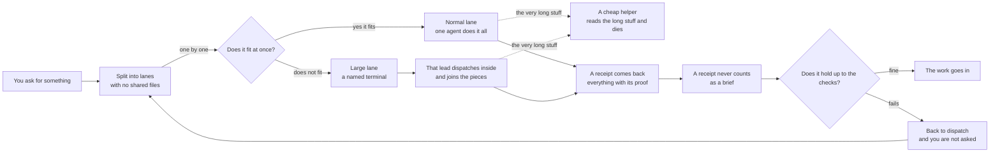
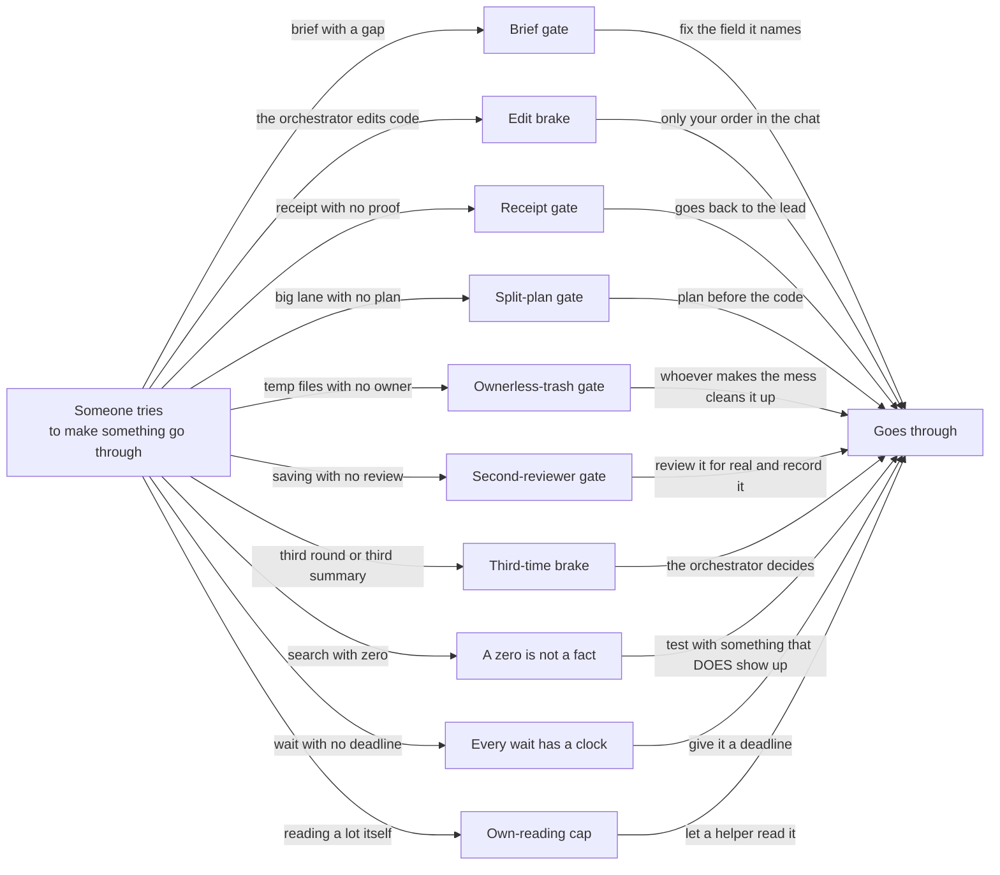
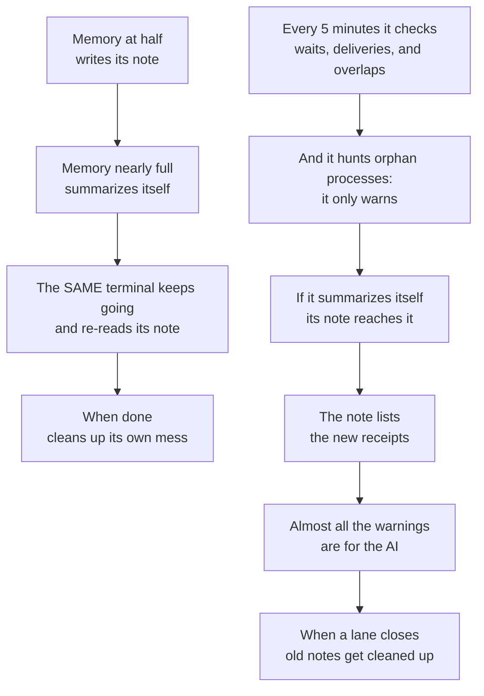

# How this skill works, in three diagrams

This skill turns ONE terminal into the **orchestrator**. The orchestrator **does not build**: it
splits your brief into chunks, hands them to others, and checks what comes back before letting it in.

Three diagrams, and nothing else: **1.** how it dispatches · **2.** the locks · **3.** what happens
on its own.

> Inside the diagrams there is not a single command or path: just plain words.
> The commands and files are in the table below each diagram.

## The odd words, translated

| Word | What it means here |
|---|---|
| **lane** | A chunk of the work, with its own files. Given to ONE single person or agent. They are called T1, T2, T3… |
| **brief** | The paper handed to a lane BEFORE it starts, with everything already decided inside |
| **receipt** | The paper it hands back when done: everything it claims, with the proof next to it |
| **lock** | A program that blocks the way until something is met. It does not warn: it does not let through |
| **lane lead** | Whoever handles a whole lane: builds it, checks it, and hands back the receipt. **It DOES touch the code** |
| **compact** | When a terminal's memory fills up, it summarizes itself so it can keep going. **The terminal does NOT close and does NOT get swapped for another**: it is the same one, with less detail |
| **handover** | The note a terminal writes **to itself** before compacting, so it remembers afterward |
| **pulse** | An automatic look every 5 minutes, so nothing sits waiting without anyone seeing it |
| **orphan** | A program that is still alive after its terminal closed. Example: a watcher left running with nobody to warn |

---

# Diagram 1 — How work gets dispatched



**The same diagram in plain text:**

```
  YOU ASK FOR SOMETHING
        |
        v
  SPLIT INTO LANES  (with no shared files)
        |
        v  one by one
  <DOES IT FIT AT ONCE?>
        |
        +-- YES --> NORMAL LANE ....... one agent does it all ........+
        |                                        :                    |
        |                                        : the very long stuff|
        |                                        v                    |
        |                              A CHEAP HELPER                |
        |                              reads the long stuff and dies |
        |                                        ^                    |
        |                                        : the very long stuff|
        +-- NO --> BIG LANE                      :                    |
                   a named terminal              :                    |
                        |                        :                    |
                        v                        :                    |
                   THAT LEAD DISPATCHES INSIDE ..+                    |
                   and joins what comes back to it                   |
                        |                                             |
                        +--------------------+------------------------+
                                             v
                                    A RECEIPT COMES BACK
                                    everything with its proof
                                             |
                                             v
                                    A RECEIPT NEVER COUNTS
                                    as a brief
                                             |
                                             v
                                   <DOES IT HOLD UP TO THE CHECKS?>
                                       |             |
                                   fine|             |fails
                                       v             v
                               THE WORK GOES IN   BACK TO DISPATCH
                                                  (and you are not asked)
                                                       |
                                                       +--> goes back up,
                                                            to "split into lanes"
```

### The only thing that changes if there are open terminals, or if there are only agents

| | **WITH terminals** | **WITHOUT terminals (agents only)** |
|---|---|---|
| **Large** lane | Goes to a named terminal, and that lead dispatches inside | Goes to a lead agent, which launches its own helpers |
| **Normal** lane | One agent | One agent |
| Several at once | Each terminal keeps going on its own | They get launched in ONE single message, or go one at a time |
| When done | **Nobody closes terminals**: the same one keeps going, even if it summarized itself | The agent dies; its receipt stays written on disk |

### Who is who

| Who | What it does | Model | Where it is defined |
|---|---|---|---|
| **The orchestrator** | Dispatches, checks, and decides. **Never builds** | Fable | `SKILL.md` (the core and the two prohibitions) |
| **Lane lead** | Does its whole lane and hands back ONE receipt. **Does touch the code** | Opus | `agents/lane-lead.md` (`model: opus`) |
| **A lead's sub-agents** | The chunks of a big lane: the hard part to Opus, the standard part to Sonnet, the mechanical part to Haiku | Opus / Sonnet / Haiku | `references/dispatch.md`, the table of who does what (command tiers) |
| **Disposable reader** | Opens the long stuff (logs, suites), summarizes in at most 30 lines, and dies | Haiku | `agents/disposable-reader.md` (`model: haiku`), `references/dispatch.md`, "Disposable reader" row |
| **Receipt verifier** | Checks a receipt's claims one by one | Sonnet | `agents/receipt-verifier.md` (`model: sonnet`) |
| **Codex Sol** | Second opinion from **another provider** before saving to history | gpt-5.6-sol | `scripts/orchestrator-control.js`, subcommand `review` |

### Table 1 — each box, and its real command or file

| Box in the diagram | What it really does | Real command or file |
|---|---|---|
| You ask for something | Starts everything. Loading the skill inside the repository already starts the watching | `SKILL.md`; by hand, subcommand `start` |
| Split into lanes | A lane = one scope, an **exclusive file list**, its own folder, and resources with their own name | `references/dispatch.md` (STEP 2), `references/brief-template.md` |
| Does it fit at once? | The **lane size**. The orchestrator measures it, never the lead | `references/dispatch.md`, "Lane size: who measures it, and what changes" |
| Normal lane | A lead agent does it start to finish | `agents/lane-lead.md` |
| Large lane | Goes to a named terminal, and its brief orders it to load the mini-orchestrator manual | `references/dispatch.md` ("Lane size"), `references/mini-orchestrator.md` |
| That lead dispatches inside | Splits by files with no overlap, writes its plan **before the first code change**, launches in parallel, and joins the sub-receipts | `references/mini-orchestrator.md`, "STEP A — Split before launching anything" |
| A cheap helper | Nobody expensive reads long logs: a single-use reader opens them | `agents/disposable-reader.md`, `references/dispatch.md` ("Disposable reader") |
| A receipt comes back | Seven fixed headings; everything claimed has the command that proves it pasted right next to it | `references/receipt-template.md` |
| A receipt never counts as a brief | **Nothing** written in the receipts folder is noted as a dispatched brief, whatever it is called (even if its name says "brief"). The ones called `T<n>…` also go to their own list of receipts (at most 10 per console command) | `scripts/orchestrator-control.js`: `isDispatch` excludes the folder (`RE_RECEIPTS_FOLDER`, `.orchestrator/receipts/`); `RE_RECEIPT_PATH` (only `T<n>…`); cap of 10 (`RECEIPTS_WRITTEN_MAX` area) |
| Does it hold up to the checks? | First the mechanical gate; then the orchestrator **opens two claims itself**; then the second reviewer | `references/receipt-template.md` ("The marker rule", and the sampling steps); subcommands `validate` and `review` |
| The work goes in | The entry order set at dispatch is **provisional**: it gets recomputed against what really changed | `SKILL.md` (law 5); subcommand `integrate` |
| Back to dispatch | A lane that fails **gets dispatched again** — another brief or another lane — without asking you. The orchestrator only touches code if you order it in the chat | `SKILL.md` ("The orchestrator does NOT edit code"); `orchestrator.config.json` |

---

# Diagram 2 — The locks

A lock **does not warn: it does not let through.** Each one has something that opens it.



**The same diagram in plain text, in three columns:**

```
 WHAT TRIES TO GO THROUGH          LOCK                          WHAT OPENS IT
 ---------------------------------------------------------------------------------------------
 1  a badly written brief    -->  brief gate                -->  you fix the field it names
                                                                   for you
 2  the ORCHESTRATOR wants   -->  edit brake                -->  only your order in the chat
    to edit code                  (the only one that cuts        (valid 30 min, one single
                                    today)                        file)
 3  receipt with no proof,   -->  receipt gate              -->  goes back to the lead, with
    or with a changed                                             nobody reading its prose
    heading
 4  a BIG lane with no     -->  receipt gate              -->  the plan, written BEFORE the
    split plan                                                    first code change
 5  temp files left with     -->  receipt gate              -->  whoever makes the mess cleans
    no owner                                                      it up: deletes them or
                                                                    declares them
 6  saving to history with   -->  second-reviewer gate      -->  reviewing it for real and
    no second opinion                                             getting it recorded
 7  third pass over the      -->  third-time brake          -->  the orchestrator decides:
    same piece, or a lead          (round / summary)             continue / escalate / redo,
    summarized for the                                            or a NEW brief to THAT SAME
    third time                                                    terminal
 8  a search that returned   -->  "a zero is not a         -->  test with something that
    zero results                  fact"                           SHOULD show up
 9  a wait with no           -->  "every wait has a         -->  you give it a deadline; the
    deadline                      clock"                          5-min pulse watches it
10  the orchestrator reads   -->  own-reading cap           -->  let a cheap helper read it,
    400 lines or more                                             and it reads its summary
    itself in one turn
```

### Table 2 — each lock, and where it lives

| # | Lock | Does it really cut, or is it a rule the AI obeys? | Where it lives |
|---|---|---|---|
| 1 | Brief gate | **Cuts**: it exits with an error and names the field and its fix | Subcommand `validate --brief`; `references/control-phase-1-and-2.md`, "How to drive it by hand" section, "You just wrote a brief" row |
| 2 | Edit brake | **Really cuts, and it is the only warning from the program itself that blocks something today.** Denies writing or editing code to the terminal that loaded the skill — not to a lane's lead, who does edit | Gate `orchestrator_builds`; turned on in `orchestrator.config.json`; the key is the subcommand `allow-edit`, with your order; `references/control-phase-1-and-2.md`, "What will BLOCK in phase 2" section, `orchestrator_builds` row |
| 3 | Receipt gate | **Cuts**: the receipt goes back with nobody reading its prose. Typical failure: long prose before the proof command (40 characters are tolerated, no more) | Subcommand `validate --receipt`; `references/receipt-template.md` ("The marker rule") |
| 4 | Split-plan gate | **Cuts**: a big lane that says "0 subagents" with no explanation, or with no plan written before the code, gets rejected | Subcommand `validate --receipt`; `references/control-phase-1-and-2.md`, "How to drive it by hand" section, "The receipt of a BIG lane arrives" row; `references/mini-orchestrator.md`, "STEP A" |
| 5 | Ownerless-trash gate | **Cuts**: new files the receipt does not name bring it down. Whoever makes the mess cleans it up | Subcommand `validate --receipt` |
| 6 | Second-reviewer gate (optional) | **Cuts**, if you use one: it blocks saving to history if the change has no recorded review. And `review --help` launches nothing: with an orchestration running it prints the options; without one, it says there is none | your own review gate, if you have one (it lives outside this skill; orq works without it); `review --help` in `scripts/orchestrator-control.js` (the `review` subcommand) |
| 7 | Third-time brake | **A rule the AI obeys**, plus a warning. It covers two things: **the third round** over the same piece (for example, of Codex), where the orchestrator stops and decides — there is no fourth without a decision —; and **the third time a lead summarizes itself**, where its memory is already a summary of summaries and it gets written a new, complete brief, **to that same terminal**. Nobody closes terminals | `SKILL.md` (law 4); gate `third_round` (in the `GATES` table of `scripts/orchestrator-control.js`); recorded with subcommand `decide`; `orchestrator.config.json` (`compactions_per_brief`); gate `lane_handoff` |
| 8 | A zero is not a fact | **A rule the AI obeys**, plus a warning. Zero results prove nothing until the same method finds something that does exist | `SKILL.md` (law 3); gate `zero_unchecked`; subcommand `zero --control`; `references/control-phase-1-and-2.md`, "How to drive it by hand" section, "A search returned ZERO" row |
| 9 | Every wait has a clock | **A rule the AI obeys**, plus a warning from the 5-minute pulse | `SKILL.md` (law 4); gate `wait_expired`; subcommand `wait --deadline`; `references/control-phase-1-and-2.md`, "How to drive it by hand" section, "You start waiting for something" row |
| 10 | Own-reading cap | **A rule the AI obeys**, plus a warning: it cannot cut, because the reading is already done by the time the program sees it. If the orchestrator itself reads **400 lines or more** in one turn, it is warned once: the long stuff gets opened by a disposable reader | Gate `own_reading` (`scripts/orchestrator-control.js`, `checkOwnReading`); threshold `own_reading_lines` in `orchestrator.config.json` (400; the default is `OWN_READING_LINES` in the script) |

> **Why the distinction matters:** today only locks 1 through 6 block the way. 7 through 10 are
> written laws the AI follows, with a warning that reminds it. Saying all of them cut would be
> promising a brake that does not exist.

---

# Diagram 3 — What happens on its own, with nobody asking



*(Left column: **while a lead works**. Right column: **while the orchestrator works**. Two things
running at the same time, without touching each other.)*

**The same diagram in plain text:**

```
 WHILE A LEAD WORKS                     WHILE THE ORCHESTRATOR WORKS
 ----------------------------------     --------------------------------------------
 memory at HALF                         every 5 MINUTES it checks:
   -> writes its note to disk             - waits that already expired
                                          - deliveries that changed state
 memory NEARLY FULL                       - lanes starting to step on each other
   -> summarizes itself                 and hunts ORPHAN processes:
                                          -> only warns, never kills anything
 the SAME terminal keeps going
   -> and re-reads its note             if IT summarizes itself
   -> nobody closes it or swaps it        -> its own note reaches it, right
                                             in front
                                          -> the note lists the new receipts

                                        of all the warnings, almost all are
 on the THIRD time                      ONLY FOR THE AI; only FOUR reach your
   -> new brief, same terminal          screen, the ones that need YOU to
                                        type or decide something
 when done
   -> cleans up its temp files          when a lane closes
                                          -> its old notes get deleted,
                                             except the latest one
```

### Table 3 — what each number is, and where it comes from

| What happens on its own | The exact detail | Where it lives |
|---|---|---|
| Memory at half | At **500,000** tokens it warns that same terminal: "write your note now" | `orchestrator.config.json` (`warn_tokens`); gate `own_load` |
| Memory nearly full | At **600,000** it summarizes itself. The whole window is 1,000,000, i.e. 100% | `orchestrator.config.json` (`airbag_tokens`); `autoCompactWindow` in `settings.json` |
| The same terminal keeps going | On returning from summarizing itself, the first thing it receives is its own note. **Nobody closes or relaunches terminals** | `<repo root>/.orchestrator/handovers/`; gate `lane_handoff` |
| On the third time | A new, complete brief, to that same terminal | `orchestrator.config.json` (`compactions_per_brief`) |
| When done, it cleans up its own mess | The receipt has to say "Temporaries deleted: yes" with the list. A "no" gets sent back | `references/receipt-template.md` |
| Every 5 minutes | A watcher calls the pulse. **It stays quiet if nothing changed**, so as not to wake anyone up for nothing | Subcommand `pulse`; `SKILL.md` (the core) |
| And it hunts orphan processes | On every pulse it looks for watcher programs that have been alive for **more than 5 minutes** without their terminal. It warns **once** per process and **never kills**: it leaves you the command so you decide | `scripts/orchestrator-control.js`: `orphanHookProcesses` and `warnOrphans` (inside `pulse`); `L.orphans_warned`; "I have killed nothing" in the same function. **NOT TESTED ON macOS** (the process listing and the command it leaves are the platform-dependent part) |
| If the orchestrator summarizes itself | Its handoff sheet gets put in front of it, written from the ledger | Subcommand `handoff`; `<.git folder>/orchestrator-handoff.md` |
| If the orchestrator hands over to another terminal | The new one inherits the command, the permits and the rules **without closing the program**: the old one prepares it and the new one takes it (or takes it by itself if the old one has been **10 min** with no signal) | Subcommand `relieve` (`--prepare` / `--take`); `references/control-phase-1-and-2.md`, "The owner's handoff: the new terminal inherits command without closing anything" section |
| The note lists the new receipts | Its handoff sheet carries "Receipts since your handover": the lane receipts written **after** its note, so it does not wait for something already on disk | `scripts/orchestrator-control.js`: `L.receipts_written` in the handoff sheet; `noteReceipt` (where they get noted) |
| Almost all the warnings are for the AI | Only **four** things reach your screen: that the folder is not a repository, that the airbag is out of sync, that orchestration started, and the brake when it denies | `references/control-phase-1-and-2.md`, "What the owner sees on screen, and what only the AI sees" section |
| When a lane closes | When its receipt passes the gate, its old notes get deleted **except the latest one**: its terminal is still alive | `references/control-phase-1-and-2.md`, "What the hook cleans up, and when" section |

---

## How to open the version you can interact with

- **`docs/map.html`** is the **click map**: the same drawing as the cover, and clicking a piece shows its real wiring (down to the lead of a BIG lane and its mini-orchestrator).
- **`docs/circuit.html`** is **the three static diagrams** of this file, to read top to bottom.

Next to this file is **`docs/circuit.html`**: **the three diagrams** with their color-coded boxes
and tables, on a single page. It is hand-written, in plain HTML and CSS: one single file, no
libraries, **no internet connection needed**, and nothing to install.

**Double-click** `docs/circuit.html` in Finder, or open it from a terminal with:
`open ~/.claude/skills/orq/docs/circuit.html` (**NOT TESTED ON macOS**; if the skill lives elsewhere,
use the folder that holds this file).

The colors mean the same thing in all three diagrams: **green** for what goes through, **red** for
the lock that cuts, **gray** for what waits or helps. Everything, buttons included, is in English —
because there are no buttons: it is a page you read top to bottom.
